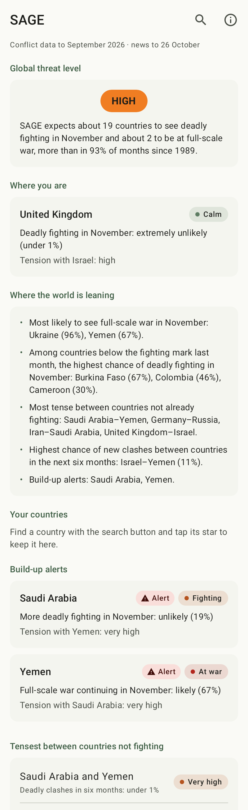
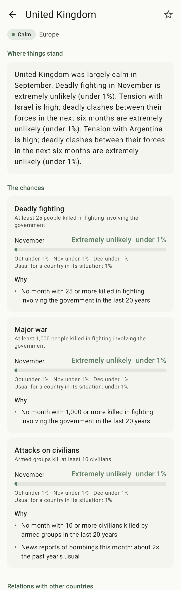
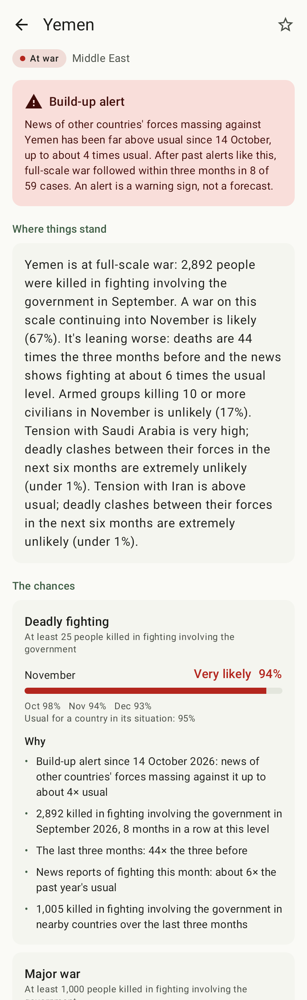

# SAGE for Android

This folder is the Android app. The forecaster it shows is the rest of the
repository.

SAGE's war and conflict forecasts on your phone, in plain English: where the
world is leaning, the countries you follow, build-up alerts, and how tense
things are between countries. Free, no ads, no accounts.

<p>



</p>

## What it shows

- **Global threat level:** Low, Guarded, Elevated, High or Severe, in its
  colour, saying how next month compares with every month since 1989 for the
  world as a whole.
- **Home:** a few sentences on where the world is leaning, the country you're
  in, the countries you've starred, any build-up alerts, and the tensest pairs
  of countries that aren't fighting.
- **Where you are:** found from your internet connection (Cloudflare's
  connection check, `cdn-cgi/trace`), or failing that the phone's mobile
  network, SIM or region setting. Only the country is kept.
- **A country:** where things stand, the chance of deadly fighting, major war
  and attacks on civilians over the next three months (in words and numbers,
  against what's usual), why, and its relations with other countries.
- **Two countries:** how tense things are and the chance of deadly clashes or
  war in the next six months.
- **Since you last looked:** when a newer forecast comes in, the home screen
  says what got worse in the countries you follow: a build-up alert starting,
  a chance of fighting rising to a new level, or tension with another country
  rising to high or above.

## Where the forecasts come from

The app downloads one public file, `forecasts/latest.json`, made by the SAGE
project. It looks for it at:

```
https://hostu404.github.io/SAGE/forecasts/latest.json
```

That's GitHub Pages for this repository (Hostu404/SAGE), serving from the
root of its main branch, where the daily run writes the file. If the
repository moves, change `FORECAST_URL` in
`app/src/main/java/com/hostu404/sage/data/ForecastStore.kt`.

A copy of the file ships inside the app (`app/src/main/assets/latest.json`),
so it works from the first launch, offline or before the site is up. Before
each release, copy the latest one in: `cp ../forecasts/latest.json
app/src/main/assets/`.
Refresh it from the SAGE project before each release.

## Building

```
./gradlew assembleRelease      # app/build/outputs/apk/release/app-release.apk
./gradlew testDebugUnitTest    # forecast reading, what changed, screenshots
```

The release build is signed with the debug key so it installs straight from
the file. A Play Store build would use a real upload key. Screenshots are
written to `app/build/outputs/roborazzi/`.

## Privacy

No permissions beyond internet access (which Android grants without asking),
no notifications, no background work, no accounts, no tracking, no analytics.
The app downloads the forecast file when you open it, at most once an hour,
and asks Cloudflare which country the connection is in; only the country is
kept, on the phone, with the countries you follow.

SAGE is a statistical forecast, not a warning service. For travel and
safety, follow official advice.

Data: UCDP (CC BY 4.0), the GDELT Project, the Correlates of War Project;
checked against ViEWS. See the SAGE project for details.

## Licence

Apache License 2.0, like the rest of the repository: see `LICENSE` and
`NOTICE` at the top of the repository. Copies must keep the notice that
credits SAGE. The forecasts the app shows are CC BY 4.0 (`LICENSE-CONTENT`).
