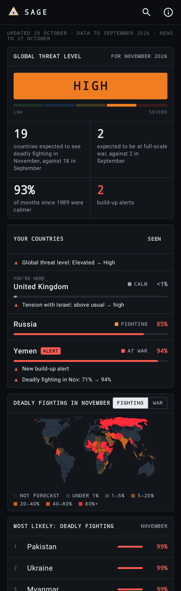
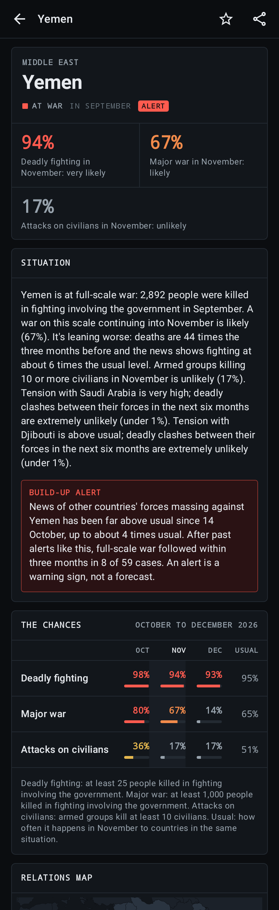
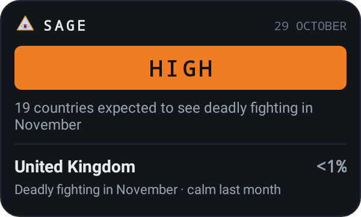

<p align="center"></p>

# SAGE for Android

This folder is the Android app. The forecaster it shows is the rest of the
repository.

SAGE's war and conflict forecasts on your phone: the same dark dashboard as
[wysesage.xyz](https://wysesage.xyz), plus your own watchlist, a home-screen
widget and sharing. Free, no ads, no accounts.

**[Download the latest version](https://github.com/Hostu404/SAGE/releases/latest/download/app-release.apk)**
(Android 8.0 or newer). Open the file and allow installing from your
browser or files app if asked.

<p>




</p>

## What it shows

Everything on the website:

- **Global threat level:** Low, Guarded, Elevated, High or Severe, in its
  colour with the five-step meter, and the numbers behind it.
- **The risk map:** every country shaded by its chance of deadly fighting or
  full-scale war next month; tap one to see it, then open it.
- **Most likely, build-up alerts, the tensest relations, a summary, and every
  country**, sortable by name or by either chance.
- **A country:** its chances for the three months the forecast covers, against
  what's usual, why, a map of its relations (tap a neighbour to open the two
  of them) and the list of them.
- **Two countries:** how tense, the chance of deadly clashes or war in six
  months, and a map of both.
- **Search** that knows the names people use: UK, USA, DRC, Côte d'Ivoire.

And what only the app does:

- **Your countries:** where you are, and every country you star, first on the
  home screen. Each shows what moved since you last looked, either way: a
  chance up or down, a build-up alert starting or ending, tension with
  another country changing, the global level moving. "Seen" starts afresh.
- **A home-screen widget:** the global threat level and where you are (or
  your first starred country), updated a few times a day.
- **Sharing:** any country or pair as a picture card, with a link to its page
  on wysesage.xyz.
- **Offline:** it works from the last forecast it downloaded, and from the
  copy it ships with.
- **Where you are:** found from your internet connection (Cloudflare's
  connection check, `cdn-cgi/trace`), or failing that the phone's mobile
  network, SIM or region setting. Only the country is kept.

## Where the forecasts come from

The app downloads one public file, `forecasts/latest.json`, made by the SAGE
project. It looks for it at:

```
https://hostu404.github.io/SAGE/forecasts/latest.json
```

That's GitHub Pages for this repository (Hostu404/SAGE), serving from the
root of its main branch, where the daily run writes the file. If the
repository moves, change `FORECAST_URL` in
`app/src/main/java/com/hostu404/sage/data/ForecastStore.kt`.

A copy of the file ships inside the app (`app/src/main/assets/latest.json`),
so it works from the first launch, offline or before the site is up. Before
each release, copy the latest one in: `cp ../forecasts/latest.json
app/src/main/assets/`, and the map if it changed: `cp ../site/world.json
app/src/main/assets/`.

## Building

```
./gradlew assembleRelease      # app/build/outputs/apk/release/app-release.apk
./gradlew testDebugUnitTest    # forecast reading, watchlist, search, map, screenshots
```

The release build is signed with the debug key so it installs straight from
the file. For a real release, use Android Studio's Build → Generate Signed
App Bundle or APK with your own key, kept outside the repository, and attach
the APK to a GitHub release under Android Studio's own name,
`app-release.apk`, so the download link above always gets the newest one. Screenshots are
written to `app/build/outputs/roborazzi/`.

## Privacy

No accounts, no tracking, no analytics, no notifications. Two permissions,
both granted without asking: internet access, and checking whether the phone
is online (so the widget's refresh waits for a network). The app downloads
the forecast file when you open it, at most once an hour; if you've added
the widget, Android also wakes it every few hours to fetch the file. It asks
Cloudflare which country the connection is in; only the country is kept, on
the phone, with the countries you follow and what they looked like when you
last marked them seen. Share cards are made on the phone and only go where
you send them.

SAGE is a statistical forecast, not a warning service. For travel and
safety, follow official advice.

Data: UCDP (CC BY 4.0), the GDELT Project, the Correlates of War Project;
checked against ViEWS. Map: Natural Earth (public domain), the same file as
the website (`app/src/main/assets/world.json`, from `site/world.json`). See
the SAGE project for details.

## Licence

Apache License 2.0, like the rest of the repository: see `LICENSE` and
`NOTICE` at the top of the repository. Copies must keep the notice that
credits SAGE. The forecasts the app shows are CC BY 4.0 (`LICENSE-CONTENT`).
