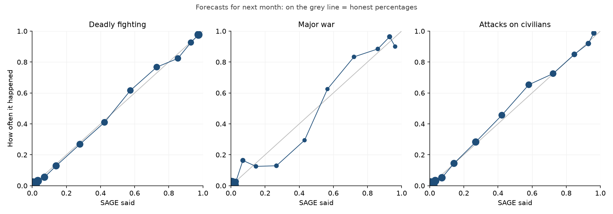

# How SAGE would have done, 2018 to now

SAGE replayed every month from Jan 2018 to Sep 2026: each forecast was made using only the data that existed at the time, then checked against what actually happened. The model was retrained each January on everything up to the December before.

Data: UCDP conflict deaths (checked data to 2025, monthly candidate data after), up to October 2026. 130 countries: every country with organised violence recorded since 1989.

## The short version (forecasts for next month)

| Question | SAGE vs "same as last month" | SAGE vs the base rate | Percentages honest? |
|---|---|---|---|
| **Deadly fighting**: at least 25 people killed in fighting involving the government in a month | 21% smaller error | 74% smaller error | off by 0.4% on average |
| **Major war**: at least 1,000 people killed in fighting involving the government in a month | 22% smaller error | 66% smaller error | off by 0.2% on average |
| **Attacks on civilians**: armed groups kill at least 10 civilians in a month | 18% smaller error | 56% smaller error | off by 0.5% on average |

"Same as last month" is the forecast to beat: it says a war that's on now will still be on, and a quiet country will stay quiet. It's right most of the time, which is why beating it at all is hard. The error measure is the Brier score: the average squared gap between the forecast and what happened.

## Compared with ViEWS

ViEWS (Uppsala University and PRIO) publishes monthly forecasts of the same "deadly fighting" question. On the same countries and months, using the ViEWS forecast that was out when SAGE made its own (Jan 2022 to Sep 2026), the error of each (lower is better):

| | This month | Next month | The month after |
|---|---|---|---|
| SAGE | 0.0274 | 0.0301 | 0.0310 |
| ViEWS | 0.0363 | 0.0363 | 0.0388 |
| Same as last month | 0.0352 | 0.0384 | 0.0389 |
| Average of SAGE and ViEWS | 0.0291 | 0.0312 | 0.0329 |

Averaging the two was worse than SAGE alone, so SAGE doesn't use ViEWS's numbers. This only covers the 130 countries SAGE follows, not every country ViEWS forecasts.

## Build-up alerts

Checked every day. An alert goes out when three warning signs in the last 14 days of news are all at least 2.7 times their usual level over the year before: other countries' forces mobilising against the country, showing force at it, and threatening it. Alert days less than a week apart count as one alert. It's a flag, not a forecast: it marks the rare stretches that look like the run-up to past wars.

77 alerts since April 2014. What followed between each alert starting and 90 days after it ended, in that country, where it hadn't happened in the 90 days before ("in a month" here means any 30 days):

| | After an alert | After a random day |
|---|---|---|
| Deadly fighting | 8 of 35 (23%) | 3.7% |
| Major war | 8 of 59 (14%) | 0.6% |
| Attacks on civilians | 4 of 50 (8%) | 3.5% |

The same test on a country's own forces (its forces mobilising, shows of force in it, threats by it) went off 154 times, mostly after terror attacks, when police and soldiers fill the streets; deadly fighting followed 15 of 92 times (16%), against 23% for alerts about forces aimed at a country. So only the latter raise alerts; the own-forces signs still feed into the forecasts.

Every alert so far (✔ = followed, ✘ = didn't, · = had already happened in the 90 days before, … = too recent to tell):

| Country | From | To | Peak | Deadly fighting | Major war | Attacks on civilians |
|---|---|---|---|---|---|---|
| Mexico | 17 Feb 2017 | 21 Feb 2017 | 3.7× | ✘ | ✘ | ✘ |
| Mexico | 3 Feb 2025 | 16 Feb 2025 | 3.8× | ✘ | ✘ | · |
| Venezuela | 15 Feb 2019 | 16 Feb 2019 | 2.8× | ✘ | ✘ | ✘ |
| Venezuela | 25 Feb 2019 | 9 Mar 2019 | 3.1× | ✘ | ✘ | ✘ |
| Venezuela | 3 Sep 2025 | 4 Sep 2025 | 2.8× | ✘ | ✘ | ✘ |
| Venezuela | 5 Jan 2026 | 19 Jan 2026 | 6.7× | · | ✘ | ✘ |
| Belgium | 22 Mar 2016 | 6 Apr 2016 | 10.3× | ✘ | ✘ | ✘ |
| France | 19 Jan 2015 | 25 Jan 2015 | 3.1× | ✘ | ✘ | ✘ |
| France | 15 Nov 2015 | 3 Dec 2015 | 7.4× | ✘ | ✘ | · |
| Poland | 2 Aug 2023 | 6 Aug 2023 | 3.6× | ✘ | ✘ | ✘ |
| Cyprus | 10 Mar 2026 | 15 Mar 2026 | 2.8× | ✘ | ✘ | ✘ |
| Russia | 3 Mar 2014 | 6 Apr 2014 | 6.3× | · | ✘ | · |
| Russia | 16 Apr 2014 | 30 Apr 2014 | 4.0× | ✔ | ✘ | ✘ |
| Russia | 25 Nov 2021 | 20 Dec 2021 | 3.8× | ✘ | ✘ | ✘ |
| Russia | 19 Jan 2022 | 11 Mar 2022 | 8.2× | ✘ | ✘ | ✘ |
| Ukraine | 27 Feb 2014 | 12 May 2014 | 18.1× | · | ✔ | ✘ |
| Ukraine | 30 Nov 2018 | 11 Dec 2018 | 3.7× | · | ✘ | ✘ |
| Ukraine | 5 Apr 2021 | 24 Apr 2021 | 4.5× | · | ✘ | ✘ |
| Ukraine | 25 Nov 2021 | 10 Mar 2022 | 11.2× | ✔ | ✔ | ✘ |
| Armenia | 30 Sep 2020 | 19 Oct 2020 | 3.3× | ✘ | ✘ | ✘ |
| Azerbaijan | 29 Sep 2020 | 15 Oct 2020 | 4.5× | · | · | ✘ |
| Gambia | 19 Jan 2017 | 1 Feb 2017 | 4.6× | ✘ | ✘ | ✘ |
| Mali | 26 Nov 2015 | 4 Dec 2015 | 3.8× | ✘ | ✘ | ✘ |
| Senegal | 21 Jan 2017 | 25 Jan 2017 | 2.9× | ✘ | ✘ | ✘ |
| Niger | 9 Feb 2015 | 19 Feb 2015 | 3.7× | · | ✘ | ✔ |
| Niger | 1 Aug 2023 | 31 Aug 2023 | 11.5× | ✔ | ✘ | ✔ |
| Nigeria | 13 May 2014 | 19 May 2014 | 3.5× | · | ✘ | · |
| Somalia | 26 Sep 2013 | 7 Oct 2013 | 3.0× | · | ✘ | · |
| Tunisia | 27 Jun 2015 | 9 Jul 2015 | 3.2× | ✘ | ✘ | · |
| Libya | 7 Jan 2020 | 29 Jan 2020 | 3.8× | · | ✘ | ✘ |
| Sudan | 23 Apr 2023 | 7 May 2023 | 3.9× | · | ✔ | · |
| South Sudan | 20 Dec 2013 | 2 Jan 2014 | 6.1× | · | ✘ | · |
| Iran | 22 Apr 2015 | 23 Apr 2015 | 2.7× | ✘ | ✘ | ✘ |
| Iran | 10 May 2018 | 17 May 2018 | 3.6× | ✔ | ✘ | ✘ |
| Iran | 16 May 2019 | 2 Jun 2019 | 5.3× | ✘ | ✘ | ✘ |
| Iran | 26 Jun 2019 | 1 Jul 2019 | 3.6× | ✘ | ✘ | ✘ |
| Iran | 5 Jan 2020 | 21 Jan 2020 | 5.9× | ✔ | ✘ | ✘ |
| Iran | 25 Oct 2023 | 29 Oct 2023 | 3.0× | ✘ | ✘ | ✔ |
| Iran | 13 Apr 2024 | 27 Apr 2024 | 6.2× | · | ✘ | ✘ |
| Iran | 30 Jan 2026 | 5 Feb 2026 | 3.2× | ✔ | ✔ | ✘ |
| Iran | 20 Feb 2026 | 10 Apr 2026 | 12.3× | ✔ | ✔ | ✘ |
| Turkey | 5 Dec 2015 | 28 Dec 2015 | 6.4× | · | ✘ | · |
| Turkey | 13 Oct 2019 | 29 Oct 2019 | 9.3× | · | ✘ | ✘ |
| Iraq | 16 Jun 2014 | 11 Jul 2014 | 9.0× | · | · | · |
| Iraq | 11 Sep 2014 | 30 Sep 2014 | 3.9× | · | · | · |
| Iraq | 3 Jan 2020 | 21 Jan 2020 | 7.4× | · | ✘ | ✘ |
| Egypt | 7 Jul 2013 | 17 Jul 2013 | 3.0× | ✘ | ✘ | ✘ |
| Egypt | 15 Nov 2015 | 18 Nov 2015 | 3.0× | · | ✘ | · |
| Syria | 29 Aug 2013 | 17 Sep 2013 | 5.0× | · | · | · |
| Syria | 26 Sep 2014 | 7 Oct 2014 | 3.9× | · | · | · |
| Syria | 6 Oct 2015 | 21 Oct 2015 | 4.1× | · | · | · |
| Syria | 25 Nov 2015 | 10 Dec 2015 | 3.9× | · | · | · |
| Syria | 14 Feb 2016 | 22 Feb 2016 | 3.3× | · | · | · |
| Syria | 18 Apr 2018 | 22 Apr 2018 | 2.7× | · | · | · |
| Syria | 14 Oct 2019 | 30 Oct 2019 | 5.5× | · | · | · |
| Syria | 9 Dec 2024 | 26 Dec 2024 | 5.4× | · | · | · |
| Lebanon | 3 Sep 2019 | 8 Sep 2019 | 2.8× | ✘ | ✘ | ✘ |
| Lebanon | 13 Oct 2023 | 3 Nov 2023 | 5.9× | · | ✘ | ✘ |
| Lebanon | 25 Sep 2024 | 21 Oct 2024 | 5.0× | · | ✔ | ✘ |
| Lebanon | 3 Mar 2026 | 31 Mar 2026 | 7.1× | · | · | ✘ |
| Jordan | 8 Feb 2024 | 8 Feb 2024 | 2.9× | ✘ | ✘ | ✘ |
| Israel | 13 Jul 2014 | 9 Aug 2014 | 4.8× | · | ✔ | ✘ |
| Israel | 10 Dec 2017 | 20 Dec 2017 | 3.6× | ✘ | ✘ | ✘ |
| Israel | 12 May 2021 | 31 May 2021 | 8.7× | · | ✘ | ✘ |
| Israel | 8 Oct 2023 | 17 Nov 2023 | 25.3× | · | · | · |
| Saudi Arabia | 2 Apr 2015 | 15 Apr 2015 | 4.0× | ✔ | ✘ | ✔ |
| Saudi Arabia | 21 Sep 2019 | 4 Oct 2019 | 4.7× | ✘ | ✘ | ✘ |
| Saudi Arabia | 12 Oct 2026 | 28 Oct 2026 | 4.7× | · | … | … |
| Yemen | 26 Mar 2015 | 28 Apr 2015 | 8.3× | · | ✔ | ✘ |
| Yemen | 14 Oct 2026 | 25 Oct 2026 | 3.5× | · | · | · |
| Qatar | 14 Jun 2017 | 1 Jul 2017 | 3.4× | ✘ | ✘ | ✘ |
| Afghanistan | 25 Aug 2017 | 4 Sep 2017 | 3.5× | · | · | · |
| Afghanistan | 13 Jul 2021 | 21 Jul 2021 | 3.1× | · | · | · |
| Afghanistan | 15 Aug 2021 | 9 Sep 2021 | 11.1× | · | · | · |
| Pakistan | 8 May 2025 | 21 May 2025 | 3.8× | · | ✘ | · |
| Myanmar | 27 Nov 2016 | 4 Dec 2016 | 4.1× | · | ✘ | ✘ |
| Cambodia | 30 Jul 2025 | 6 Aug 2025 | 2.8× | · | ✘ | ✘ |

## Deadly fighting

At least 25 people killed in fighting involving the government, in a given month.

| | This month (made mid-month) | Next month | The month after |
|---|---|---|---|
| Forecasts checked | 13,650 | 13,520 | 13,390 |
| Times it happened | 1,739 | 1,727 | 1,712 |
| Error: SAGE | 0.0270 | 0.0297 | 0.0310 |
| Error: same as last month | 0.0351 | 0.0375 | 0.0389 |
| Error: base rate | 0.1121 | 0.1123 | 0.1124 |
| SAGE better than last month by | 23% | 21% | 20% |
| Ranking (AUC: 50% = guessing, 100% = perfect) | 98.8% | 98.5% | 98.4% |

When SAGE said… (next month)

| SAGE said | Forecasts | It happened |
|---|---|---|
| 0%–2% (avg 0.3%) | 9,670 | 0.2% |
| 2%–5% (avg 3.3%) | 783 | 3.1% |
| 5%–10% (avg 7.2%) | 436 | 5.5% |
| 10%–20% (avg 14.0%) | 389 | 12.9% |
| 20%–35% (avg 27.9%) | 328 | 26.8% |
| 35%–50% (avg 42.3%) | 283 | 41.0% |
| 50%–65% (avg 57.5%) | 237 | 61.6% |
| 65%–80% (avg 73.0%) | 262 | 76.7% |
| 80%–90% (avg 85.4%) | 221 | 82.4% |
| 90%–95% (avg 93.0%) | 190 | 92.6% |
| 95%–100% (avg 97.4%) | 721 | 97.6% |

**New outbreaks** (after 12+ calm months): 61 happened in 10,654 calm country-months. SAGE rated those that happened at 5.7% on average, against 0.7% for places that stayed calm, so it does point at the right places (ranking 92%), but almost never with confidence: it went above 20% 6 times, 2 of which happened.

Biggest surprises: Sri Lanka, Mar 2026 (SAGE said 0.1%); Kyrgyzstan, Apr 2021 (SAGE said 0.1%); Lebanon, Oct 2023 (SAGE said 0.2%); Cambodia, Jul 2025 (SAGE said 0.3%); Tanzania, Oct 2020 (SAGE said 0.3%); Haiti, Mar 2024 (SAGE said 0.6%).

Year by year (next month):

| Year | Forecasts | Happened | Better than last month by |
|---|---|---|---|
| 2018 | 1,560 | 172 | 18% |
| 2019 | 1,560 | 181 | 18% |
| 2020 | 1,560 | 182 | 13% |
| 2021 | 1,560 | 200 | 30% |
| 2022 | 1,560 | 190 | 25% |
| 2023 | 1,560 | 193 | 17% |
| 2024 | 1,560 | 235 | 22% |
| 2025 | 1,560 | 225 | 20% |
| 2026 | 1,040 | 149 | 27% |

## Major war

At least 1,000 people killed in fighting involving the government, in a given month.

| | This month (made mid-month) | Next month | The month after |
|---|---|---|---|
| Forecasts checked | 13,650 | 13,520 | 13,390 |
| Times it happened | 173 | 171 | 169 |
| Error: SAGE | 0.0036 | 0.0043 | 0.0049 |
| Error: same as last month | 0.0043 | 0.0055 | 0.0059 |
| Error: base rate | 0.0126 | 0.0125 | 0.0125 |
| SAGE better than last month by | 17% | 22% | 17% |
| Ranking (AUC: 50% = guessing, 100% = perfect) | 99.0% | 98.5% | 97.8% |

When SAGE said… (next month)

| SAGE said | Forecasts | It happened |
|---|---|---|
| 0%–2% (avg 0.1%) | 13,101 | 0.2% |
| 2%–5% (avg 2.9%) | 151 | 2.6% |
| 5%–10% (avg 7.0%) | 55 | 16.4% |
| 10%–20% (avg 14.6%) | 24 | 12.5% |
| 20%–35% (avg 26.6%) | 31 | 12.9% |
| 35%–50% (avg 43.1%) | 17 | 29.4% |
| 50%–65% (avg 56.5%) | 16 | 62.5% |
| 65%–80% (avg 72.1%) | 24 | 83.3% |
| 80%–90% (avg 86.0%) | 26 | 88.5% |
| 90%–95% (avg 93.0%) | 55 | 96.4% |
| 95%–100% (avg 96.2%) | 20 | 90.0% |

**New outbreaks** (after 12+ calm months): 21 happened in 13,143 calm country-months. SAGE rated those that happened at 1.2% on average, against 0.1% for places that stayed calm, so it does point at the right places (ranking 90%), but almost never with confidence: it went above 20% 0 times, 0 of which happened.

Biggest surprises: Ethiopia, Nov 2020 (SAGE said 0.0%); Azerbaijan, Oct 2020 (SAGE said 0.0%); Sudan, Apr 2023 (SAGE said 0.1%); Israel, Oct 2023 (SAGE said 0.2%); Iran, Jun 2025 (SAGE said 0.3%); DR Congo, Jan 2025 (SAGE said 0.3%).

Year by year (next month):

| Year | Forecasts | Happened | Better than last month by |
|---|---|---|---|
| 2018 | 1,560 | 16 | 29% |
| 2019 | 1,560 | 17 | 28% |
| 2020 | 1,560 | 19 | 42% |
| 2021 | 1,560 | 16 | 15% |
| 2022 | 1,560 | 14 | 4% |
| 2023 | 1,560 | 20 | 26% |
| 2024 | 1,560 | 33 | 1% |
| 2025 | 1,560 | 24 | 32% |
| 2026 | 1,040 | 12 | 19% |

## Attacks on civilians

Armed groups kill at least 10 civilians, in a given month.

| | This month (made mid-month) | Next month | The month after |
|---|---|---|---|
| Forecasts checked | 13,650 | 13,520 | 13,390 |
| Times it happened | 1,006 | 1,000 | 992 |
| Error: SAGE | 0.0285 | 0.0301 | 0.0309 |
| Error: same as last month | 0.0356 | 0.0369 | 0.0377 |
| Error: base rate | 0.0687 | 0.0689 | 0.0691 |
| SAGE better than last month by | 20% | 18% | 18% |
| Ranking (AUC: 50% = guessing, 100% = perfect) | 97.8% | 97.4% | 97.2% |

When SAGE said… (next month)

| SAGE said | Forecasts | It happened |
|---|---|---|
| 0%–2% (avg 0.3%) | 10,379 | 0.2% |
| 2%–5% (avg 3.3%) | 733 | 3.1% |
| 5%–10% (avg 7.2%) | 484 | 5.2% |
| 10%–20% (avg 14.2%) | 381 | 14.4% |
| 20%–35% (avg 27.0%) | 435 | 28.3% |
| 35%–50% (avg 42.3%) | 296 | 45.6% |
| 50%–65% (avg 58.1%) | 271 | 65.3% |
| 65%–80% (avg 72.3%) | 262 | 72.5% |
| 80%–90% (avg 84.8%) | 113 | 85.0% |
| 90%–95% (avg 93.0%) | 87 | 92.0% |
| 95%–100% (avg 96.2%) | 79 | 98.7% |

**New outbreaks** (after 12+ calm months): 57 happened in 11,299 calm country-months. SAGE rated those that happened at 5.6% on average, against 0.7% for places that stayed calm, so it does point at the right places (ranking 90%), but almost never with confidence: it went above 20% 7 times, 2 of which happened.

Biggest surprises: Argentina, Jan 2022 (SAGE said 0.1%); Sri Lanka, Apr 2019 (SAGE said 0.1%); Haiti, May 2020 (SAGE said 0.2%); Papua New Guinea, Jul 2024 (SAGE said 0.4%); Uganda, Jun 2023 (SAGE said 0.7%); Iran, Jan 2024 (SAGE said 0.8%).

Year by year (next month):

| Year | Forecasts | Happened | Better than last month by |
|---|---|---|---|
| 2018 | 1,560 | 102 | 20% |
| 2019 | 1,560 | 91 | 13% |
| 2020 | 1,560 | 95 | 16% |
| 2021 | 1,560 | 107 | 21% |
| 2022 | 1,560 | 121 | 11% |
| 2023 | 1,560 | 127 | 21% |
| 2024 | 1,560 | 132 | 22% |
| 2025 | 1,560 | 126 | 24% |
| 2026 | 1,040 | 99 | 14% |

## Between countries

For every pair of countries with real friction between them, SAGE reads each side's actions towards the other in the news (criticism, sanctions, threats, shows of force, mobilisation, fighting), compares them with the pair's usual, adds whether they share a border and their record of deadly disputes since 1816 (Correlates of War), and forecasts whether their forces will clash (at least one death in fighting between the two governments, UCDP) or go to war (1,000 or more deaths in a month) within the next 3 or 6 months. Replayed every month from 2008, using only what was known at the time.

| | Pair-months | It happened | Error: SAGE | Error: "clashed recently?" | Ranking (AUC) |
|---|---|---|---|---|---|
| Deadly clashes, within 3 months | 174,832 | 523 | 0.00148 | 0.00169 | 98.7% |
| Deadly clashes, within 6 months | 172,480 | 689 | 0.00184 | 0.00215 | 97.7% |
| War, within 3 months | 174,832 | 60 | 0.00012 | 0.00032 | 100.0% |
| War, within 6 months | 172,480 | 63 | 0.00015 | 0.00034 | 99.5% |

"Clashed recently?" says pairs that fought in the last six months will fight again, and others won't: the forecast to beat. For **new clashes** (pairs that hadn't fought for a year or more), 165 of 171,652 pair-months saw fighting within six months; SAGE rated those at 5.1% on average, against 0.06% for pairs that stayed calm (ranking 91%).

When SAGE said… (deadly clashes within 6 months)

| SAGE said | Pair-months | It happened |
|---|---|---|
| 0%–2% (avg 0.0%) | 171,131 | 0.1% |
| 2%–5% (avg 3.2%) | 266 | 6.0% |
| 5%–10% (avg 7.2%) | 134 | 10.4% |
| 10%–20% (avg 14.2%) | 133 | 25.6% |
| 20%–35% (avg 26.5%) | 117 | 32.5% |
| 35%–50% (avg 42.1%) | 97 | 46.4% |
| 50%–65% (avg 57.9%) | 119 | 51.3% |
| 65%–80% (avg 72.3%) | 158 | 65.8% |
| 80%–90% (avg 85.3%) | 117 | 71.8% |
| 90%–95% (avg 93.0%) | 123 | 91.1% |
| 95%–100% (avg 96.2%) | 85 | 90.6% |

Before well-known clashes: the chance SAGE gave of deadly clashes within six months, the month before and three months before, and where that ranked among all the pairs it follows (1 = the highest in the world that month):

| Clash | Began | A month before | Three months before |
|---|---|---|---|
| Russia–Ukraine, Crimea and Donbas | Mar 2014 | 1.2% (#5 of 784) | 0.1% (#29 of 784) |
| China–India, Galwan valley | Jun 2020 | 0.4% (#9 of 784) | 0.1% (#69 of 784) |
| India–Pakistan, Pulwama and Balakot | Feb 2019 | 96.2% (#1 of 784) | 94.6% (#1 of 784) |
| Russia–Ukraine, full invasion | Feb 2022 | 1.7% (#7 of 784) | 3.3% (#10 of 784) |
| Iran–Israel, first direct strikes | Apr 2024 | 95.0% (#2 of 784) | 97.4% (#1 of 784) |
| India–Pakistan, Operation Sindoor | May 2025 | 92.2% (#2 of 784) | 84.4% (#5 of 784) |
| Thailand–Cambodia border war | Jul 2025 | 82.0% (#7 of 784) | 0.2% (#24 of 784) |
| United States–Venezuela | Jan 2026 | 2.7% (#8 of 784) | 0.2% (#17 of 784) |

## Before the big surprises

What SAGE said before wars that started suddenly. A forecast for a month is made in the middle of the month before ("next month"), or two months before ("the month after"), using conflict data to the end of the previous month and the news so far.

| War | Began | Question | Forecast a month before | Two months before | Build-up alert before? |
|---|---|---|---|---|---|
| Russia's full invasion of Ukraine | 24 Feb 2022 | Deadly fighting | 17.0% | 37.5% | Yes, from 25 Nov 2021 (91 days before) |
| Russia's full invasion of Ukraine | 24 Feb 2022 | Major war | 6.1% | 0.3% | Yes, from 25 Nov 2021 (91 days before) |
| Hamas's 7 October attack and the Gaza war | 7 Oct 2023 | Deadly fighting | 22.3% | 36.3% | No |
| Hamas's 7 October attack and the Gaza war | 7 Oct 2023 | Major war | 0.2% | 0.3% | No |
| Sudan's civil war | 15 Apr 2023 | Deadly fighting | 7.4% | 4.8% | No |
| Sudan's civil war | 15 Apr 2023 | Major war | 0.1% | 0.0% | No |

## Caveats

- The backtest uses UCDP's checked data for 2018–2025; live forecasts use their monthly candidate data, which is rougher, so live results may be a little worse. The live record will show it.
- Surprise attacks planned in secret (like 7 October) leave little or no trace in public news, so no forecaster working from public information can be expected to catch them reliably.
